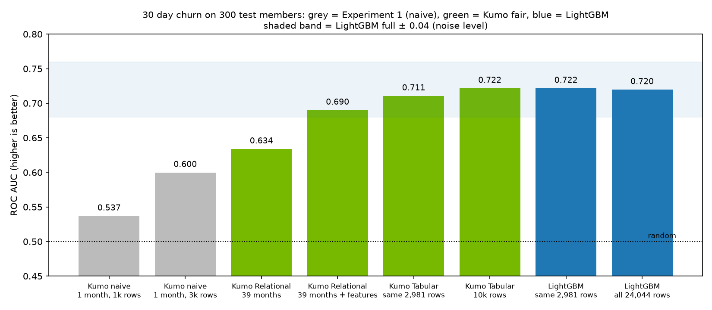
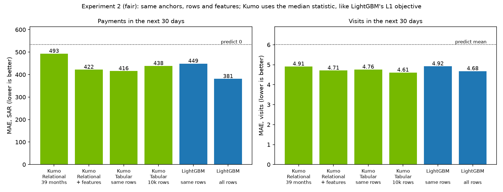
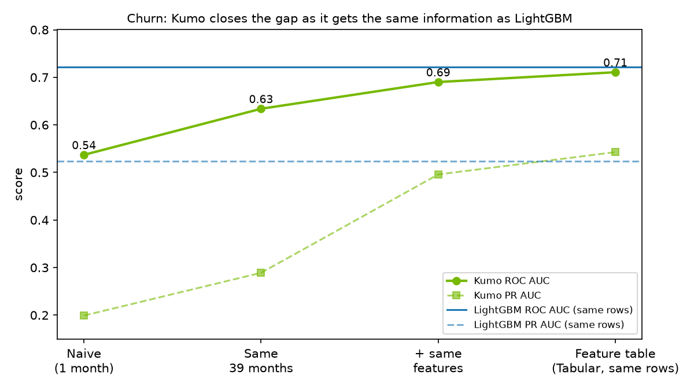

# Can a foundation model with zero training match gradient boosting on gym retention?

**A hypothesis test on a synthetic gym dataset: Kumo (relational and tabular foundation models, hosted by NVIDIA) vs LightGBM.**

Author: Víctor Andrés Gómez López

This project is part of the author's personal portfolio and is also shared as an ADAPTY case study for gyms.

Dataset on Kaggle: https://www.kaggle.com/datasets/vctorandrsgmezlpez/synthetic-gym-membership-relational-dataset



## Headline findings

1. **When both models get the same information, the foundation model matches LightGBM on churn.** Kumo Tabular gets ROC AUC 0.722 and LightGBM 0.720, on 300 test members. Neither model had any training or tuning for this test month.
2. **The first, naive comparison was misleading.** Kumo scored 0.54 there, close to random, because it saw one month of examples, no engineered features and a slightly different target.
3. **With the same number of examples (2,981 rows), Kumo is equal or better on all three tasks.** Churn 0.711 vs 0.722 AUC (tied), payments MAE 416 vs 449 SAR, visits MAE 4.76 vs 4.92.
4. **LightGBM keeps an edge on revenue when it can use 8x more data.** Its MAE is 381 SAR vs 416 SAR for the best Kumo variant. Kumo's context is capped at 10,000 rows, and LightGBM trained on 24,044.
5. **What moved the needle most was feature engineering and domain knowledge, not the choice of model.** Giving Kumo the same hand-made features raised its churn AUC from 0.63 to 0.69 (relational) and 0.71 (tabular).

## Hypothesis

* **H1:** A pretrained relational or tabular foundation model, used with no training (in-context learning only), matches a trained gradient boosting model on three gym prediction tasks:
  * 30 day churn
  * 30 day revenue per member
  * 30 day visit count
* **H0:** The trained gradient boosting model is clearly better, beyond the noise level of the test (about 0.04 ROC AUC, about 30 SAR MAE).

## Motivation

Gym operators lose a large share of members every month, and keeping a member costs far less than finding a new one. A retention team needs three numbers for each member:

* Who is about to stop coming.
* How much revenue they are likely to bring next month.
* How often they will visit.

Classic machine learning can answer these, but it needs a data scientist to build features, train, validate and maintain models. Foundation models for structured data promise predictions straight from the raw tables with no training step. If that promise holds, small operators could get churn scores without a modeling team. This project tests the promise honestly, on data shaped like a real gym's.

## Dataset

The data is **100% synthetic** and contains no real records. It is generated by `generate.py` (seed 42, fully reproducible). The table structure and a few aggregate shapes were set by hand to resemble a real gym in Riyadh, Saudi Arabia:

* plan mix and prices in SAR, with 15% VAT
* monthly renewal gaps
* visit days per active month
* weekly and Ramadan visit patterns
* denied turnstile swipes
* personal training packages

No real name, phone, ID or row was used.

The data runs from 2023-01-01 to 2026-08-31 and covers 3,000 members.

| Table | Rows | Key | Links to | Content |
|---|---|---|---|---|
| members | 3,000 | member_id | | join date, age, home club, gender, corporate flag |
| plans | 8 | plan_id | | plan name, type, duration, net price |
| contracts | 12,096 | contract_id | member_id, plan_id | start and end date of each membership |
| payments | 13,237 | payment_id | member_id, contract_id, plan_id | net, VAT, gross, method, source, discount, refund |
| visits | 251,340 | visit_id | member_id | turnstile swipes, Allowed or Denied with reason |
| trainers | 25 | trainer_id | | role, hire date |
| pt_packages | 2,211 | package_id | member_id | personal training packages bought |
| pt_sessions | 14,006 | session_id | package_id, member_id, trainer_id | sessions completed or cancelled |

`data/` holds each table as Parquet (used by the scripts) and as gzipped CSV. It also holds `churn_features.parquet`, the derived monthly feature table built by `baseline.py`.

## Method

* **Prediction moment (anchor):** 2026-07-01. Every target covers the 30 days after it.
* **Test set:** 300 members, drawn at random (seed 0) from the 1,153 members who had at least one allowed visit in the 30 days before the anchor. 53 of them (17.7%) churned. Every number in Experiments 1 and 2 is measured on these same 300 members.
* **No leakage:** every table is cut at the anchor before it reaches Kumo, and the ground truth comes from the full tables. LightGBM trains only on monthly anchors whose 30 day label window ends before the test anchor (anchors up to 2026-05-01).
* **Targets:**
  * churn: no allowed visit in the next 30 days
  * revenue: sum of net payments, excluding refunds, in the next 30 days
  * visits: count of allowed visits in the next 30 days
* **Metrics:**
  * churn: ROC AUC, PR AUC and precision in the top 10% of scores
  * revenue and visits: mean absolute error (MAE)
* **LightGBM features (16):**
  * visits in the last 7, 30 and 90 days
  * denied swipes in the last 30 days
  * days since the last visit
  * spend in the last 90 days and in total
  * number of membership payments
  * days to contract end
  * plan type
  * number of contracts
  * personal training sessions and spend
  * tenure
  * age
  * visit trend

  LightGBM uses a classifier for churn and an L1 (median) regressor for revenue and visits.
* **Kumo:** NVIDIA hosted endpoints for Kumo Relational and Kumo Tabular, called through `structured-data-models-client`. Kumo learns from labelled context examples sent in the same request. There is no training step.

## Standalone baseline (`baseline.py`)

`baseline.py` builds the monthly feature table and also prints a quick sanity check of the features, stored in `results/baseline_results.json`. It uses a different, wider split than the experiments below, so its numbers are not comparable with them:

* **Unit:** one row per member and monthly anchor (member month), not one row per member.
* **Train:** 18,831 rows from the 34 anchors 2023-03-01 to 2025-12-01.
* **Test:** 8,666 rows from the 8 anchors 2026-01-01 to 2026-08-01 (1,007 to 1,206 active members per month, 1,879 distinct members). 19.2% of them churned.

| Model | ROC AUC | PR AUC | Top 10% precision |
|---|---|---|---|
| LightGBM | 0.696 | 0.514 | 0.654 |
| Logistic regression | 0.692 | 0.449 | 0.568 |
| Days since last visit (no model) | 0.659 | 0.338 | 0.461 |

The Kumo comparison does not use this split. It uses one anchor (2026-07-01) and the 300 members described above, because each Kumo call scores a fixed set of members at a single anchor.

## Experiment 1: naive comparison

Kumo Relational gets the raw tables and its default context: up to 1,000 or 3,000 labelled examples taken from **a single month** (the month before the anchor). In this run, visits included denied swipes and the revenue and visits queries had no population filter.

| Model | Churn ROC AUC | PR AUC | Top 10% precision | Revenue MAE (SAR) | Visits MAE |
|---|---|---|---|---|---|
| LightGBM (all training rows) | **0.735** | **0.568** | **0.700** | **373** | **4.67** |
| Kumo Relational, 1,000 context rows, median | 0.537 | 0.199 | 0.233 | 530 | 5.50 |
| Kumo Relational, 1,000 context rows, mean | 0.537 | 0.199 | 0.233 | 837 | 5.44 |
| Kumo Relational, 3,000 context rows, mean | 0.600 | 0.286 | 0.267 | 733 | 5.12 |
| Baseline: predict 0 / predict mean | 0.500 | 0.177 | | 534 | 6.01 |

On this evidence H0 would win easily. But the two models did not see the same information.

## Experiment 2: fair comparison

These changes give both models the same information:

* **Same anchors.** Kumo's context comes from the same 39 monthly anchors LightGBM trained on, 2023-03-01 to 2026-05-01. That is 77 members per month, 2,981 rows, merged into one request.
* **Same population.** Every query uses LightGBM's filter: visited in the previous 30 days.
* **Same targets.** Denied swipes moved to their own table and refunds were removed. All 2,981 of Kumo's context labels match LightGBM's labels.
* **Same features.**
  * *Relational + features*: the 16 LightGBM features are added as columns on each member row, each computed at that row's own anchor.
  * *Tabular*: Kumo gets exactly LightGBM's feature table.
* **Same rows.** A restricted LightGBM is trained on exactly the 2,981 rows Kumo saw.
* **Same statistic.** For MAE, Kumo is asked for the median, which is what LightGBM's L1 objective predicts.

### Churn (higher is better)

| Variant | ROC AUC | PR AUC | Top 10% precision |
|---|---|---|---|
| LightGBM, all 24,044 rows | 0.720 | 0.561 | **0.733** |
| LightGBM, same 2,981 rows | **0.722** | 0.523 | 0.700 |
| Kumo Tabular, 10,000 rows (endpoint maximum) | **0.722** | 0.556 | 0.700 |
| Kumo Tabular, same 2,981 rows | 0.711 | 0.543 | 0.700 |
| Kumo Relational + features | 0.690 | 0.496 | 0.500 |
| Kumo Relational, raw tables, 39 months | 0.634 | 0.289 | 0.433 |

### Revenue and visits, next 30 days (MAE, lower is better)

| Variant | Revenue MAE (SAR) | Visits MAE |
|---|---|---|
| LightGBM, all rows | **381** | 4.68 |
| LightGBM, same rows | 449 | 4.92 |
| Kumo Tabular, 10,000 rows | 438 | **4.61** |
| Kumo Tabular, same rows | 416 | 4.76 |
| Kumo Relational + features | 422 | 4.71 |
| Kumo Relational, raw tables | 493 | 4.91 |
| Baseline: predict 0 / predict mean | 534 | 6.01 |

With Kumo's mean statistic instead of the median, revenue MAE is 559 to 724 and visits MAE is 4.71 to 5.07. See `results/experiment2/`.





### Latency (one call, 300 members predicted)

| Model | Request size | Response time |
|---|---|---|
| Kumo Tabular | 0.4 to 1.2 MB | 1 to 3 s |
| Kumo Relational | about 9 MB | 15 to 37 s |
| LightGBM (local CPU) | | a few seconds to train and predict |

## Conclusion

* **H1 is supported when the information is equal.**
  * On churn and visits, the foundation model with no training is statistically tied with a trained LightGBM.
  * With the same number of examples it is as good or better on all three tasks, including revenue.
* **H0 holds only in one place:** revenue, when LightGBM can use 8x more history than fits in Kumo's context. Revenue depends on exact renewal dates, and more examples help.
* **The bigger lesson is about information, not algorithms.** The jump from AUC 0.54 to 0.72 came from:
  * showing the model the right months
  * defining the target the way the business does
  * adding features a domain expert would build: days to contract end, recent visit counts, visit trend

  On raw tables alone, Kumo Relational stayed well behind. Domain knowledge about how gym members behave is what makes either model useful.
* **Practical reading for a gym operator:**
  * A tabular foundation model is a fast, training free way to score members once a good feature table exists.
  * Gradient boosting remains the stronger choice when years of history are available and revenue accuracy matters.

## Limitations

* **Synthetic data.** Patterns were designed by hand and may be easier or harder than real behavior.
* **One test month (July 2026) and 300 members, with 53 churners.** Differences below about 0.04 ROC AUC or about 30 SAR MAE are within noise.
* **No hyperparameter tuning** for LightGBM. In Experiment 1 its AUC was 0.735; in Experiment 2 the shared configuration gives 0.720.
* **API limits shaped the design:**
  * Kumo Relational allows 1,000 context rows in fast mode and 10,000 in best mode.
  * The request body is capped at 30 MiB: 6,000 relational rows failed with HTTP 413.
  * Kumo Tabular allows up to 10,000 context rows.
  * Kumo Relational samples at most 32 visits per member.
  * The client library has no built-in way to send context from several months, so `fair_trial.py` materializes one request per month and merges them. 22 rows the engine returned before the first anchor were dropped.
* **Hosted endpoints can change.** Results reflect the endpoints as of 1 November 2026.

## How to reproduce

Requires Python 3.12 or newer (numpy 2.5 needs it). Tested with Python 3.13. Create a virtual environment and install the requirements:

```bash
python -m venv .venv && source .venv/bin/activate
pip install -r requirements.txt
```

`requirements.txt` pins the direct dependencies. `requirements-lock.txt` pins every package of the tested environment, if you want an exact copy.

Regenerate the data and run the baseline. Both are deterministic and need no API key. On a clean install they reproduce the shipped Parquet files byte for byte and `results/baseline_results.json` exactly. `generate.py` writes plain CSV files next to the Parquet files; the repository ships them gzipped.

```bash
python generate.py
python baseline.py
```

Without any API key, `python kumo_trial.py --backend dry` builds the Kumo requests locally, sends nothing, and still scores the LightGBM baseline of Experiment 1 (ROC AUC 0.735, revenue MAE 373, visits MAE 4.67).

Set your own NVIDIA API key, a free key from build.nvidia.com. Never write it into a file or commit it.

```bash
export NVIDIA_API_KEY="<your key>"
```

Run Experiment 1. The defaults are 1,000 context rows and the median statistic.

```bash
python kumo_trial.py
```

Run Experiment 2. The first run uses the mean statistic; the second reruns revenue and visits with the median.

```bash
python fair_trial.py
FAIR_STAT=median FAIR_TASKS=revenue_30d,visits_30d python fair_trial.py
```

Redraw the charts from `results/`:

```bash
python make_figures.py
```

New runs write to `results/` (`kumo_trial_*.json`, `fair_results.json`). The results shipped here are in `results/experiment1/` and `results/experiment2/`. Raw endpoint responses (`results/nvidia_*.json`, `results/fair_*_*.json`) are excluded by `.gitignore`.

## Repository layout

```
generate.py        synthetic data generator
baseline.py        monthly feature table and standalone LightGBM and logistic regression baseline
kumo_trial.py      Experiment 1 (naive Kumo vs LightGBM)
fair_trial.py      Experiment 2 (fair comparison)
make_figures.py    charts in figures/
data/              synthetic tables (Parquet and CSV.gz)
results/           summary JSON files of both experiments
figures/           PNG charts
kaggle_dataset.md, dataset-metadata.json   dataset card for the Kaggle upload
```

## License

* Code: MIT (see `LICENSE`).
* Synthetic data in `data/`: Creative Commons Attribution 4.0 International, CC BY 4.0 (see `data/LICENSE`).
